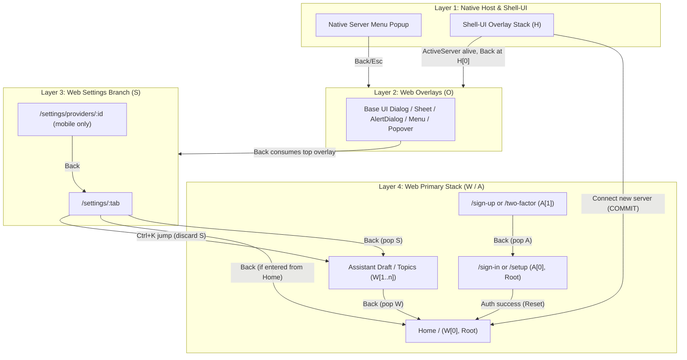

# Technical Design — Native-like App Navigation

## 1. Architecture Overview

Navigation is modeled as a **4-layer deterministic state machine** split across the Native Host (`native/desktop`, `native/mobile`), Shared Shell UI (`native/shell-ui`), and Next.js Web App (`src/`).



### Why a Logical Stack + `router.replace` in Native Mode?

JavaScript cannot selectively delete middle entries from `window.history` (e.g., removing `/settings/*` after a `Ctrl+K` jump, purging deleted topics, or deduplicating `t1 → t2 → t1`), and mixing raw `history.go(-n)` with Next.js App Router's patched `__NA` history state causes router desynchronization.

- **Native Mode (`window.pikaNative` present)**:
  - A pure TypeScript state machine (`src/lib/navigation-state.ts`) driven by `NavigationProvider` owns `(mode, workspaceStack, settingsStack, authStack)`, mirrored to `sessionStorage` so manual reloads (`Cmd+R`) preserve the logical stack within the same server session.
  - All in-app navigations execute via `router.replace(...)` (or `window.history.replaceState` when `ChatView` promotes a draft to a topic without unmounting), keeping Chromium's native WebView/WebContents history **flat (depth 1)**.
  - Consequence: Chromium's built-in Back/Forward history can never drift out of sync or resurrect `/settings/*` or `/sign-in`.
- **Standalone Browser Mode (`!window.pikaNative`)**:
  - Uses standard browser history (`router.push` for topics and entering settings) so browser Back/Forward buttons behave naturally, while applying clean `router.replace` for settings tab switches, auth completions, deletion fallbacks, and leaving settings via cross-jump (`SearchDialog`), plus `router.back()` when clicking Settings `←` if entered from an in-app route.

---

## 2. State Machine Specification

### Data Model

```ts
export const MAX_WORKSPACE_TOPICS = 20;

export type AppNavState = {
  mode: "app" | "auth";
  /** Always starts with "/" when mode === "app". Max length = 1 + MAX_WORKSPACE_TOPICS. */
  workspaceStack: string[];
  /** Non-null only while inside /settings/*. Length 1 (tab) or 2 (mobile provider detail). */
  settingsStack: string[] | null;
  /** Used when mode === "auth". Bottom is "/sign-in" or "/setup". */
  authStack: string[];
};
```

### Invariants

1. `mode === "app"` ⇒ `workspaceStack[0] === "/"` and no entry in `workspaceStack` starts with `"/settings"`.
2. `settingsStack !== null` ⇒ `mode === "app"` and every entry starts with `"/settings"`.
3. `pathname === "/"` ⇒ `settingsStack === null` and `workspaceStack.length === 1`.
4. Switching to a new server resets `AppNavState` to `{ mode: "app", workspaceStack: ["/"], settingsStack: null, authStack: [] }` (or `auth` root if server redirects to `/sign-in`) and clears the previous WebView/WebContents completely.

### Back Dispatch Priority (Highest → Lowest)

1. **Native server menu open** (`serverMenuView` / `ServerMenuDialog`) → close popup, done.
2. **`shell-ui` active**:
   - Open confirm `<dialog>` inside `shell-ui` → close dialog, done.
   - `shellStack.length > 1` → cancel any in-flight connect & pop `shellStack`, done.
   - `shellStack.length === 1`:
     - `activeServer !== null` → dismiss `shell-ui` and reveal the kept-alive server view, done.
     - `activeServer === null` → **Root behavior** (Android: OS exit to launcher; Desktop: no-op).
3. **Web overlay open** (`overlayOpen === true`) → dispatch `Escape` keydown so Base UI dismisses the topmost open modal/dialog/menu/popover/mobile sidebar sheet, done.
4. **Settings detail open** (`settingsStack?.length > 1`) → pop `settingsStack` → navigate to `settingsStack[0]` (`/settings/providers`).
5. **Settings tab open** (`settingsStack?.length === 1`) → set `settingsStack = null` → navigate to `workspaceStack.at(-1) ?? "/"`.
6. **Auth sub-page open** (`mode === "auth" && authStack.length > 1`) → pop `authStack` → navigate to `authStack.at(-1)`.
7. **Workspace depth > 1** (`mode === "app" && workspaceStack.length > 1`) → pop `workspaceStack` → navigate to `workspaceStack.at(-1)`.
8. **Root reached** (`mode === "app" && workspaceStack.length === 1` OR `mode === "auth" && authStack.length <= 1`) → **Root behavior** (Android: OS exit to launcher via disabled `OnBackPressedCallback`; Desktop: no-op).

### Key Transitions

| Event | Condition | State Update |
|---|---|---|
| `OPEN_HOME` (sidebar `←` / brand logo) | any `app` state | `settingsStack = null; workspaceStack = ["/"]` |
| `OPEN_ASSISTANT(a)` | `mode === "app"` | `settingsStack = null`; push `/assistant/${a}` onto `workspaceStack` (move-to-top dedup, cap 20) |
| `OPEN_TOPIC(a, t, { isMobile })` | `mode === "app"` | `settingsStack = null`; if `isMobile` AND `workspaceStack.at(-1)` is an assistant draft `/assistant/:any`, replace top with `/assistant/${a}/${t}`; else push with move-to-top dedup & cap 20 |
| `PROMOTE_DRAFT_TO_TOPIC(a, t, { isMobile })` | first message sent from `/` or `/assistant/:a` | If current top is `"/"`, push `/assistant/${a}/${t}` (keep `"/"` at index 0!). If current top is `/assistant/:a`, replace top with `/assistant/${a}/${t}` on mobile (and also replace on desktop since the draft just became that topic!). `ChatView` still uses `window.history.replaceState` so it never unmounts mid-stream. |
| `OPEN_SETTINGS(tab = "/settings/general")` | `mode === "app"` | Keep `workspaceStack` intact; `settingsStack = [tab]` |
| `SWITCH_SETTINGS_TAB(tab)` | `settingsStack !== null` | `settingsStack = [tab]` (replaces in place) |
| `OPEN_PROVIDER_DETAIL(id, { isMobile })` | inside `/settings/providers` | If `isMobile`: `settingsStack = ["/settings/providers", "/settings/providers/" + id]`; else `settingsStack = ["/settings/providers/" + id]` |
| `PURGE_TOPIC(topicId, fallbackHref)` | topic deleted | Remove matching topic paths from `workspaceStack`; if currently viewing it, replace top with `fallbackHref` (or pop to `"/"` if fallback is `"/"`) |
| `PURGE_ASSISTANT(assistantId)` | assistant deleted | Remove all `/assistant/${assistantId}(/.*)?` entries from `workspaceStack`; if currently viewing it, reset/navigate to `"/"` |
| `AUTH_COMPLETE` | login / signup / setup / 2FA / demo succeeds | `mode = "app"; workspaceStack = ["/"]; settingsStack = null; authStack = []` |
| `SIGN_OUT` | sign-out or session expiry | Clear `sessionStorage`; `mode = "auth"; authStack = ["/sign-in"]; workspaceStack = []; settingsStack = null` |
| `SYNC_PATHNAME(pathname)` | initial load, reload, notification deep-link, or server redirect | Reconciles state if pathname is not at current top: `/settings/*` mounts `settingsStack` (keeping `W[0] = "/"`), `/assistant/*` ensures `W[0] = "/"` and pushes pathname on top, `"/"` resets `W = ["/"]`, auth paths switch to `mode = "auth"`. |

---

## 3. Cross-Layer Contracts

### A. `window.pikaNative` Extension (`src/global.d.ts`, `preload-remote.ts`, `RemoteBridge.kt`)

Additive and optional so older shells and standalone browsers stay 100% compatible:

```ts
interface PikaNativeNavigation {
  /** Report whether the web layer will consume the next Back event (for Android predictive back). */
  setCanGoBack(canGoBack: boolean): void;
  /** Subscribe to native-triggered Back events (Android hardware/gesture Back, Desktop mouse back / shortcut / swipe). */
  onBack(listener: () => void): () => void;
}

interface PikaNative {
  // ...existing members...
  navigation?: PikaNativeNavigation;
}
```

- **Backward compatibility (newer shell ↔ older server)**:
  - Both Desktop and Android track a `webNavigationReady` boolean (flipped `true` when the page first registers `onBack` / sends `navState`).
  - If `webNavigationReady === false` (connecting to an older Pika server that does not ship `NavigationProvider`), native Back falls back to existing same-origin history `goBack()` so older servers remain functional.
- **IPC / WebMessage channels**:
  - **Desktop**:
    - Web → Main: `ipcRenderer.send("native:navState", { canGoBack: boolean })` (origin-checked via `fromRemote`, zod-validated).
    - Main → Web: `remote.view.webContents.send("native:back")` when `webNavigationReady` is true.
  - **Android**:
    - Web → Native: `pikaNativeHost.postMessage(JSON.stringify({ type: "navState", canGoBack }))` (origin + main-frame checked).
    - Native → Web: `remoteWebView.evaluateJavascript("window.__pikaDispatchBack?.()", null)` (non-writable/internal closure inside the document-start script invoking registered `onBack` listeners).

### B. `window.pikaShell` Extension (`native/shell-ui/src/host.ts`, `preload-shell.ts`, `native/mobile/src/main.ts`)

```ts
export interface PikaShell {
  // ...existing members...
  listServers(): Promise<{
    servers: Server[];
    lastServerId: string | null;
    activeServerId: string | null; // non-null when a kept-alive server view can be returned to
  }>;
  returnToServer(): Promise<void>;
  setCanGoBack?(canGoBack: boolean): void;
  onBack?(listener: () => void): () => void;
}
```

- `shell-ui` maintains `shellStack: ShellScreen[]`:
  - Entry query `?list` → `["list"]`; `?add` → `[{ kind: "form", mode: "add" }]`; `?connect=<id>` → `[{ kind: "connecting", serverId }]`; `?failed=<id>` → `[{ kind: "error", serverId }]`; `""` → auto-connect or `["welcome"]` / `[{ kind: "form", mode: "add" }]`.
  - When `activeServerId !== null`, the `list` toolbar renders a Back button (`returnToServer`) and `Esc` / native Back pops `shellStack` down to `returnToServer()`.
  - Clicking the server matching `activeServerId` directly calls `host.returnToServer()` without re-checking health or reloading.
  - Calling `saveServer` when editing `activeServerId`'s URL: host compares normalized origins; if changed, host immediately destroys the kept-alive server view so subsequent `listServers()` returns `activeServerId: null` (Back button hides; returning to the old server is impossible). If only `name` changed, host updates the kept-alive server name in place and keeps `activeServerId` returnable.
  - Calling `removeServer(id)` when `id === activeServerId`: host immediately destroys the kept-alive server view (`activeServerId` becomes `null`).
  - Whenever `shellStack`, `activeServerId`, or a confirm `<dialog>` open state changes, `shell-ui` computes `shellCanGoBack = dialogOpen || shellStack.length > 1 || activeServerId !== null` and reports `host.setCanGoBack?.(shellCanGoBack)`.

---

## 4. Platform Implementations

### A. Web App (`src/`)

1. **`src/lib/navigation-state.ts`** (pure logic + Vitest unit tests):
   - State type, reducer functions for all transitions, route classification (`isSettingsPath`, `isAuthPath`, `parseAssistantPath`), `sessionStorage` serialization with Zod validation, and `canGoBack(state)`.
2. **`src/lib/overlay-dismiss.ts`** (DOM overlay observation & dismissal):
   - Detects open dismissible overlays via a single selector targeting Base UI open popups (excluding tooltips):
     `[data-open][data-slot="dialog-content"], [data-open][data-slot="sheet-content"], [data-open][data-slot="alert-dialog-content"], [data-open][data-slot="dropdown-menu-content"], [data-open][data-slot="dropdown-menu-sub-content"], [data-open][data-slot="popover-content"], [data-open][data-slot="select-content"], [data-open][role="dialog"]`
   - Uses a `MutationObserver` on `document.body` (`subtree: true, attributes: true, attributeFilter: ["data-open"], childList: true`) to reactively track `overlayOpen` and push `canGoBack` updates to native.
   - `dismissTopOverlay()` dispatches a cancelable `KeyboardEvent("keydown", { key: "Escape", bubbles: true, cancelable: true })` on `document.activeElement ?? document.body` so Base UI's dismissal stack closes only the topmost overlay (e.g., dropdown menu inside mobile sidebar drawer closes the menu first, then the drawer on the next Back).
3. **`src/components/providers/NavigationProvider.tsx`** (mounted in `AppProviders`):
   - Connects `navigation-state.ts`, `usePathname()`, `useRouter()`, `usePikaNative()`, `useIsMobile()`, and `overlay-dismiss.ts`.
   - Subscribes to `native.navigation.onBack` and syncs `native.navigation.setCanGoBack(overlayOpen || canGoBack(state))`.
   - Exposes `useAppNavigation()` consumed by:
     - `AssistantTree.tsx`: assistant click, topic click, new-topic click, Settings `←` (`goBack()`), Assistant `←` (`navigateHome()`), delete fallbacks (`purgeDeletedAssistant` / `purgeDeletedTopic`).
     - `SettingsNav.tsx` / `SidebarNavLink.tsx`: settings tab switches (`switchSettingsTab`).
     - `SidebarUserMenu.tsx`: settings gear button (`openSettings`).
     - `CloseOnNavigateLink.tsx`: brand logo (`navigateHome`).
     - `SearchDialog.tsx`: topic/message hit navigation (`openTopic`).
     - `ProviderConfigsScreen.tsx`: detail selection & mobile back link (`openProviderDetail` / `goBack`).
     - `ChatView.tsx`: first-message draft promotion (`recordPromotedTopic` alongside `window.history.replaceState`).
     - `SignInForm.tsx`, `SignUpForm.tsx`, `SetupForm.tsx`, `TwoFactorForm.tsx`, `DemoEntry.tsx`: auth completion (`completeAuth`), plus `signOutAndReset` clearing `sessionStorage`.

### B. Desktop Shell (`native/desktop/src/main.ts` + `preload-remote.ts` + `preload-shell.ts`)

1. **Keep-alive `remote` view**:
   - Split `showShell(query, { dropRemote = false })`:
     - Default (`dropRemote: false`, used for `?list`, `?add`, `?connect=<id>`): detaches `remote.view` from `win.contentView` and attaches `shellView`, **without calling `remote.view.webContents.close()`**.
     - `dropRemote: true` (used for `?failed=<id>` when the active server fails/crashes repeatedly, or when removing/changing URL of the active server): calls `closeRemote()`.
   - Add `returnToServer()`: if `remote` exists and is not destroyed, re-attaches `remote.view` (keeping its exact DOM, scroll, draft, and streaming state) and emits titlebar state.
   - Inside `attachServerView(...)`: only closes the old `remote` here (when committing a newly connected server), creating a fresh `WebContentsView` with empty Chromium history.
   - Update `saveServer` and `removeServer` handlers:
     - `removeServer(id)`: if `remote?.server.id === id`, call `closeRemote()`.
     - `saveServer(input)`: if `remote?.server.id === server.id`:
       - URL origin changed → call `closeRemote()` (disconnect immediately per D7).
       - Name only changed → update `remote.server.name` (and window title / menu display).
2. **Unified Back & Forward Interception**:
   - `dispatchBack()`:
     1. If `serverMenuOpen` → `closeServerMenu()`.
     2. Else if `shellView` is attached → `shellView.webContents.send("shell:back")`.
     3. Else if `remote` is attached → if `remote.webNavReady`, `remote.view.webContents.send("native:back")`; else if `remote.view.webContents.navigationHistory.canGoBack()`, `goBack()` (older-server fallback). At root: **no-op**.
   - Hook all Desktop Back/Forward inputs:
     - `win.on("app-command", (_e, cmd) => { if (cmd === "browser-backward") dispatchBack(); /* swallow browser-forward */ })`.
     - macOS `win.on("swipe", (_e, dir) => { if (dir === "right") dispatchBack(); })`.
     - Attach `before-input-event` on `shellView` and `remote.view`: intercept `Alt+Left` (Win/Linux) and `Cmd+[` (macOS) → `event.preventDefault(); dispatchBack()`; intercept `Alt+Right` / `Cmd+]` / `BrowserBack` / `BrowserForward` keys → prevent Chromium's raw history navigation (calling `dispatchBack()` for `BrowserBack`). Also intercept `Escape` on `shellView` → send `shell:back`.
   - Keep `titlebar.ts` unchanged (no browser-style navigation buttons).

### C. Android Shell (`native/mobile/`)

1. **Dual-WebView Architecture (`MainActivity.kt`, `PikaHostPlugin.kt`, `RemoteBridge.kt`)**:
   - Keep Capacitor's `bridge.webView` **exclusively** on `https://localhost` (`shell-ui`) so `PikaHostPlugin` and `CapacitorHttp` never lose their Capacitor bridge.
   - Create a dedicated `remoteWebView: WebView?` added to the same parent `ViewGroup` (`bridge.webView.parent as ViewGroup`, i.e., the root `CoordinatorLayout`) beneath/beside `bridge.webView`:
     - Reuses a single `BridgeWebChromeClient(bridge)` created in `onCreate` (before `STARTED`, satisfying `registerForActivityResult` lifecycle rules) so `<input type="file">` / camera picker works on remote pages.
     - Attaches `DownloadListener` (`hostPlugin.downloadAttachment`), a dedicated `WebViewClient` (origin allowlist, `/api/files/<id>` attachment open, external links to `ACTION_VIEW`, main-frame error → show shell `?failed=<id>` with `dropRemote = true`, renderer crash → `recreate()`), and a per-view `RemoteBridge`.
     - Re-enables required WebView settings (`javaScriptEnabled`, `domStorageEnabled`, `databaseEnabled`, mixed content / user agent matching Capacitor defaults, cookie acceptance via `CookieManager`).
   - **Visibility & lifecycle**:
     - When connected and `shellVisible == false`: `remoteWebView` is `View.VISIBLE`, `bridge.webView` is `View.GONE`.
     - When `showShell(query, dropRemote = false)`: `bridge.webView` loads `https://localhost/$query` and becomes `View.VISIBLE` **above** `remoteWebView` (keeping `remoteWebView` alive at `View.INVISIBLE` so JS/SSE/drafts survive intact!).
     - When `returnToServer()`: if `remoteWebView != null`, hide `bridge.webView` (`View.GONE`), show `remoteWebView` (`View.VISIBLE`), re-apply `remoteTheme` to system bars — zero reload!
     - When `connectToServer(server)` commits: destroy the old `remoteWebView` (remove from parent + `destroy()`, eliminating WebView 133 listener-removal crashes AND guaranteeing 100% empty history!), create a brand-new `remoteWebView`, install `RemoteBridge`, load `server.url`, hide `bridge.webView`.
     - When `removeServer(id)` or `saveServer` URL-origin change affects `connectedServer`: destroy `remoteWebView`, clear `connectedServer = null`, keep `bridge.webView` visible.
     - Dual theme palettes: store `shellTheme` and `remoteTheme` separately; apply whichever view is currently foregrounded so background theme events never flicker the system bars.
   - **SystemBars insets note**: `bridge.webView` receives Capacitor `SystemBars` native insets padding via decor view (which wraps the entire `CoordinatorLayout`), so `remoteWebView` inside the same `CoordinatorLayout` inherits the exact same safe-area / IME resize behavior automatically!
2. **Predictive Back (`MainActivity.kt` + `AndroidManifest.xml`)**:
   - Add `android:enableOnBackInvokedCallback="true"` on `<application>` in `AndroidManifest.xml`.
   - Maintain:
     - `nativeMenuDialog: AlertDialog?` (track `isShowing` + `setOnDismissListener { updateBackEnabled() }`)
     - `shellVisible: Boolean` & `shellCanGoBack: Boolean`
     - `webCanGoBack: Boolean` & `webNavReady: Boolean`
   - `updateBackEnabled()`:
     ```kotlin
     val shouldIntercept = when {
         nativeMenuDialog?.isShowing == true -> false // AlertDialog handles its own Back dismissal natively
         shellVisible -> shellCanGoBack
         remoteWebView != null -> if (webNavReady) webCanGoBack else remoteWebView.canGoBack()
         else -> false
     }
     backCallback.isEnabled = shouldIntercept
     ```
   - When `backCallback.isEnabled == false` (at Home `/` or Auth root or empty shell with no overlays), Android 14+ OS directly drives the predictive back gesture animation to the launcher!
   - When `backCallback.isEnabled == true`, `handleOnBackPressed()` dispatches Back to `shell-ui` (`bridge.webView`) or `remoteWebView` (`window.__pikaDispatchBack?.()`, falling back to `remoteWebView.goBack()` if `!webNavReady`).

---

## 5. Compatibility, Trade-offs & Rollback

- **Trade-off — Dual WebView memory on Android**: While `shell-ui` is open over a connected server, two WebViews coexist briefly; `shell-ui` is a tiny static HTML/JS bundle (~20 KB), so memory overhead is negligible, and `bridge.webView` sits `View.GONE` during normal chat use. In return, backing out of the server list is instant/lossless and switching servers gets a clean WebView with zero history/listener bugs.
- **Trade-off — Synthetic Escape for Base UI overlay dismissal**: Avoids touching generated `src/components/ui/*` files. Verified via unit/DOM tests covering `Dialog`, `Sheet`, `AlertDialog`, `DropdownMenu`, `Popover`, and `ImagePreviewDialog`; if any overlay does not close on `Escape` (e.g., an `AlertDialog` with explicit disable), we verify and handle it cleanly.
- **Rollback**: Changes are modular (`navigation-state.ts`, `NavigationProvider.tsx`, optional `pikaNative.navigation`, and shell keep-alive logic). Removing `NavigationProvider` and reverting the shell view detachment restores prior behavior without any DB or API migration.
