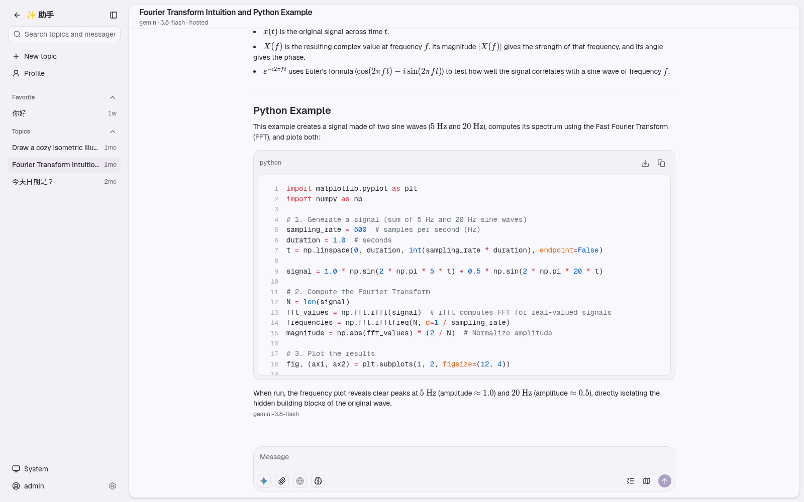
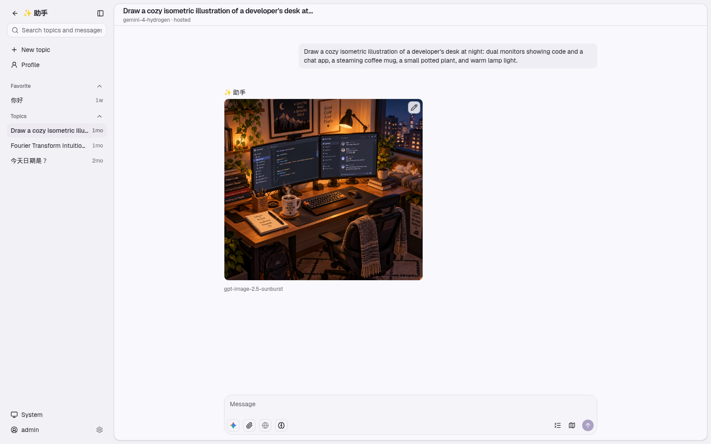
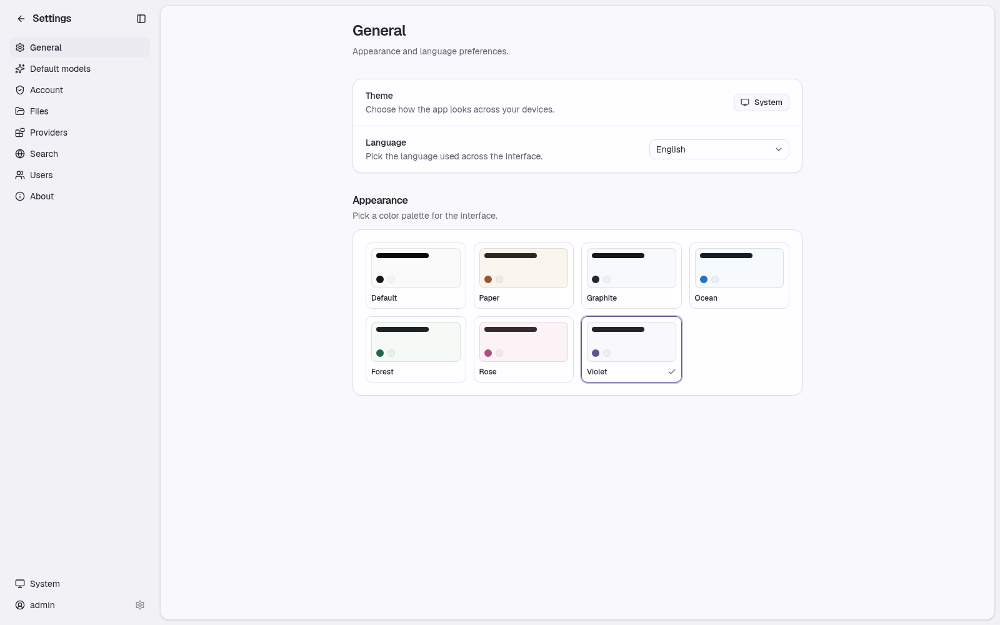
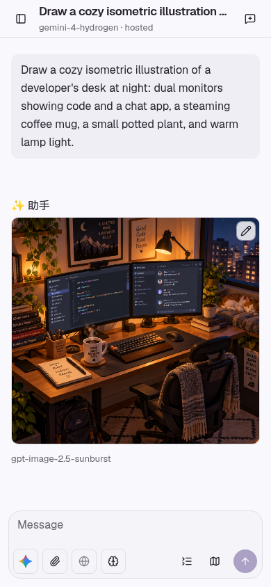

<p align="center">
  
</p>

<h1 align="center">Pika Chat</h1>

<p align="center">
  <strong>A modern, self-hosted, multimodal AI chat workspace built for speed, privacy, and control.</strong>
</p>

<p align="center">
  <a href="README.md">English</a> •
  <a href="README.zh-CN.md">简体中文</a> •
  <a href="https://pika-demo.jasonzzx.com">Live Demo</a>
</p>

<p align="center">
  
  
  
  
  
  
</p>

---

**Pika Chat** is a privacy-conscious, self-hosted AI chat platform designed for both individual power users and teams. Connect your own LLM providers, generate and edit images, search the live web with citations, upload and parse multimodal files, and organize workflows with assistants and topics — all in a clean, responsive interface that works just as smoothly on mobile touchscreens as it does on multi-monitor desktops.

<p align="center">
  
</p>

---

## Live Demo

Try Pika Chat directly in your browser without creating an account: **[https://pika-demo.jasonzzx.com](https://pika-demo.jasonzzx.com)** 

- One-click guest access using preconfigured models and web search, with daily usage quotas.
- Conversations and uploaded files are isolated to your browser session and automatically purged after 7 days of inactivity (please avoid entering sensitive information).

---

## Screenshots

| 🎨 AI Image Generation & Editing | 🌈 Theme Presets |
|:---:|:---:|
|  |  |

<p align="center">
  <br/>
  <sub>📱 Mobile-first, touch-friendly chat experience</sub>
</p>

---

## Features

### 💬 Chat & Workflow
- **Background Generation & Resume**: Replies run on the server and survive tab closes, refreshes, topic switches, and sign-outs — returning resumes live streaming without extra worker infrastructure.
- **Non-Destructive Editing & Regeneration**: Edit any sent user message or regenerate any past reply as switchable versions without truncating later turns.
- **Temporary Chat & Drafts**: Start ephemeral **Temporary** chats (auto-deleted on exit or after 24h) alongside persistent unsent drafts per topic and assistant.
- **Quote, Search & Overview**: Quote message excerpts and jump back to source passages, overview turns with **Chat map**, or search across all messages (`Ctrl+K`).
- **Compression, Translation & Stats**: Auto-compress long contexts into rolling summaries, translate messages into 8 languages with caching, and inspect per-message TPS, TTFT, and cache hits.

### 🎨 Multimodal, Image & Search
- **Built-in File Parsing & Multimodal Replay**: Parse PDF, DOCX, XLSX, PPTX, EPUB, text, images, audio, and video at upload — automatically falling back to extracted text on text-only models, with Gemini and Anthropic Files API support.
- **AI Image Generation & Editing**: Generate and edit images across OpenAI `gpt-image`, Gemini, Seedream, and Wan / Qwen-Image, reusing existing attachments as edit references.
- **Autonomous Web Search**: Multi-provider web search and deep page scraping (`Brave`, `Tavily`, `Exa`, `Firecrawl`) with configurable fallback chains and inline citations.

### 🔐 Providers, Storage & Access
- **Multi-Provider Orchestration**: Connect OpenAI, Anthropic, Gemini, Ollama, OpenRouter, DeepSeek, or any OpenAI-compatible gateway, sync models from `/v1/models`, encrypt API keys with AES-256-GCM, and share vetted configs or keep personal keys.
- **Zero-Config SQLite & Pluggable Storage**: Runs on embedded SQLite and local disk out of the box, or switches to S3-compatible object storage (AWS S3, MinIO, R2, RustFS) with optional direct browser transfers (`S3_DIRECT_ACCESS=1`).
- **RBAC, 2FA & Quotas**: Role-based access control (`Super Admin`, `Admin`, `Member`), TOTP 2FA, and per-user/global storage quotas with automatic orphan cleanup.
- **Themes & Clients**: 7 light/dark theme presets, English & Simplified Chinese UI, installable PWA, plus native Desktop (with zero-setup local mode) and Android apps.

---

## Quick Start

### Option 1: Production Standalone (`docker-compose.yml`, Recommended)

Runs Pika Chat with embedded SQLite (`/data/files/pika-chat.db`) and local disk attachment storage (or optional external S3) with persistent volume storage and automatic database migrations on boot.

1. **Clone the repository**:
   ```bash
   git clone https://github.com/jason-zzx/pika-chat.git
   cd pika-chat
   ```

2. **Configure environment variables**:
   ```bash
   cp .env.example .env
   ```
   Generate 32+ character instance secrets with:
   ```bash
   openssl rand -base64 48
   ```
   Edit `.env` to set your instance secrets and optional external S3 storage:
   ```env
   CREDENTIAL_ENCRYPTION_SECRET=your-generated-encryption-secret
   BETTER_AUTH_SECRET=your-generated-auth-secret

   # Optional: configure external S3 storage
   # S3_BUCKET=my-bucket
   # S3_ACCESS_KEY_ID=...
   # S3_SECRET_ACCESS_KEY=...
   ```

3. **Launch the application**:
   ```bash
   docker compose up -d
   ```

4. **Initialize Super Admin**:
   Open **`http://localhost:3000/setup`** in your browser to create the first administrator account.

---

### Option 2: Production All-in-One with RustFS (`docker-compose.rustfs.yml`)

Includes a bundled RustFS container for S3-compatible attachment storage. Using the same `.env` setup above, start the stack with:

```bash
docker compose -f docker-compose.rustfs.yml up -d
```

Then open **`http://localhost:3000/setup`** to create the first administrator account.

---

### Option 3: Local Development

#### Prerequisites
- **Node.js**: >= 22
- **pnpm**: 11.9+

#### Step-by-Step

1. **Clone and install dependencies**:
   ```bash
   git clone https://github.com/jason-zzx/pika-chat.git
   cd pika-chat
   pnpm install
   ```

2. **Configure environment variables**:
   ```bash
   cp .env.example .env
   ```
   Open `.env`, keep `DATABASE_PATH=.data/pika-chat.db` (or choose another path), and set `CREDENTIAL_ENCRYPTION_SECRET` and `BETTER_AUTH_SECRET` with values from `openssl rand -base64 48`.

3. **Start development server** (SQLite migrations run automatically at startup, or run `pnpm db:migrate` manually):
   ```bash
   pnpm dev
   ```

4. Visit **`http://localhost:3000/setup`** to complete initial administrator initialization.

---

## Data, Backups & Upgrades

An instance keeps all of its data in the `/data/files` volume (`files_prod_data`, named `pika-chat_files_prod_data` by Docker): the SQLite database `pika-chat.db` with its `pika-chat.db-wal` / `pika-chat.db-shm` files, and attachments stored on local disk. Attachments stored in S3 live in the bucket. Keep `CREDENTIAL_ENCRYPTION_SECRET` with your backups: without it, stored provider API keys cannot be decrypted.

### Backups

- **While stopped**: stop the app, copy the whole volume, then start it again (add `-f docker-compose.rustfs.yml` if you deployed with RustFS):
  ```bash
  docker compose stop app
  docker run --rm -v pika-chat_files_prod_data:/data -v "$PWD":/backup alpine tar czf /backup/pika-chat-data.tgz -C /data .
  docker compose start app
  ```
- **While running**: make a consistent copy of the database with `sqlite3 /data/files/pika-chat.db ".backup <target-file>"`, then copy the attachments. The app image does not include the `sqlite3` CLI, so run it from another container or host that mounts the volume. Copying only `pika-chat.db` from a running instance can miss the newest writes, which are still in `pika-chat.db-wal`.

### Upgrading from PostgreSQL

Releases before v1.0.0 stored data in PostgreSQL. On first boot, this version automatically imports your PostgreSQL data into SQLite (upgrade older instances to v0.4.2 first):

1. **Update only the image first.** Keep your previous compose file and `.env` unchanged, pull the new image, and restart (`docker compose -f <your-compose-file> pull && docker compose -f <your-compose-file> up -d`). The server reads PostgreSQL and migrates everything into `/data/files/pika-chat.db` before serving.
2. **Switch to the current compose file.** Once the import completes, switch to `docker-compose.yml` (or `docker-compose.rustfs.yml`) and run `docker compose up -d --remove-orphans`. Keep the old PostgreSQL volume until you have verified your data.

> **Switch compose files only after the import.** The new compose files no longer include PostgreSQL, so booting with them first starts an empty database. If that happens, stop the app, remove `pika-chat.db*` from the volume, and restart with your previous compose file.

---

## Android App

An Android app for connecting to one or more deployed Pika Chat servers, with theme-synced system bars, keyboard-aware layout, and system back navigation. There is no on-device server; use a remote one.

- **Install**: download `Pika-Chat-<version>.apk` from [GitHub Releases](https://github.com/jason-zzx/pika-chat/releases) and install it.
- **Multi-Server**: add and switch between multiple Pika Chat servers anytime, each with its own sign-in session.

Developing the Android app: see [`native/mobile/README.md`](native/mobile/README.md).

---

## Desktop App

A native desktop client (Electron) for Windows, macOS, and Linux that runs Pika Chat locally with no server setup or connects to remote Pika Chat servers, with system tray and global show/hide hotkey support.

- **Download** from [GitHub Releases](https://github.com/jason-zzx/pika-chat/releases).
- **Local Mode ("This computer")**: choose "Use on this computer" on first launch to run Pika Chat privately on your device with zero setup; data is stored under `<userData>/local/`.
- **Remote Servers**: connect to and switch between one or more remote Pika Chat servers anytime, each with an isolated sign-in session.
- **Windows**: builds are unsigned; on the SmartScreen dialog choose "More info" → "Run anyway".
- **macOS**: builds are unsigned; after moving the app to Applications run `xattr -dr com.apple.quarantine "/Applications/Pika Chat.app"` once.
- **Linux**: GNOME needs the AppIndicator extension for the tray icon. Without a tray, relaunching the app shows the window.

Developing the desktop app (separate pnpm workspace under `native/`):

```bash
DOCKER_BUILD=1 DATABASE_PATH=:memory: pnpm build
pnpm -C native install --frozen-lockfile
node native/desktop/scripts/build-server.mjs
pnpm -C native -r typecheck && pnpm -C native -r test
pnpm -C native/desktop start                          # run against local or remote servers
pnpm -C native/desktop dist --linux AppImage deb rpm  # local package build
```

---

## Configuration Reference

Configure Pika Chat through environment variables in your `.env` file or deployment container environment:

| Variable | Required | Default | Description |
|---|:---:|:---:|---|
| `DATABASE_PATH` | **Yes** | `/data/files/pika-chat.db` (Docker) | Path of the SQLite database file (`.data/pika-chat.db` in `.env.example` for local development, `:memory:` for throwaway runs). The compose files fix it to `/data/files/pika-chat.db` on the mounted volume. |
| `CREDENTIAL_ENCRYPTION_SECRET` | **Yes** | — | Secret key (min 32 chars) used for AES-256-GCM encryption of provider API keys at rest. **Do not lose this**; losing it orphans stored credentials permanently. |
| `BETTER_AUTH_SECRET` | **Yes** | — | Secret key (min 32 chars) used for signing Better Auth session tokens. |
| `APP_URL` | No | `http://localhost:3000` | Canonical public URL of your deployment. Required when deployed behind reverse proxies. |
| `APP_TRUSTED_ORIGINS` | No | — | Additional comma-separated trusted origins for CSRF checks and multi-address access (e.g. `http://192.168.1.100:3000,https://chat.example.com`). |
| `FILE_STORAGE_DIR` | No | `.data/files` | Local filesystem directory for storing uploaded chat attachments when S3 is not configured. |
| `FILE_UPLOAD_MAX_MB` | No | `20` | Maximum size for a single file attachment in MiB (allowed integer range: `1`–`100`). Fails fast on invalid values. |
| `S3_BUCKET` | No | — | Setting this switches attachment storage from local disk to S3-compatible object storage. Automatically bootstraps bucket if missing. |
| `S3_ENDPOINT` | No | official AWS | Custom S3 endpoint URL (e.g. `http://minio:9000` or `https://<account>.r2.cloudflarestorage.com`). Automatically forces path-style addressing for non-AWS hosts. |
| `S3_REGION` | No | `us-east-1` | S3 region identifier. |
| `S3_ACCESS_KEY_ID` | If S3 set | — | S3 access key credential. |
| `S3_SECRET_ACCESS_KEY` | If S3 set | — | S3 secret access key credential. |
| `S3_DIRECT_ACCESS` | No | off | Set to `1` or `true` to enable direct browser S3 uploads (presigned POST) and downloads (presigned 302 GET), bypassing server transfer. `0`/`false`/unset disables. Requires `S3_BUCKET`. |
| `PIKA_IMAGE` | No | `ghcr.io/jason-zzx/pika-chat:latest` | Container image tag override in Docker Compose. |

---

## Storage Architecture

```
                                  +-----------------------+
                                  |  Local Disk Storage   |
                                  |  (FILE_STORAGE_DIR)   |
                                  +-----------^-----------+
                                              |
+----------+      Upload / Download           | (default)
|  Client  | <=========================> [ App Server ]
+----+-----+                                  |
     |                                        | (if S3_BUCKET set)
     | (if S3_DIRECT_ACCESS=1)                v
     |                             +----------------------+
     +---------------------------> | S3-Compatible Store  |
        Direct Presigned POST/GET  | AWS S3 / MinIO /     |
                                   | RustFS / R2          |
                                   +----------------------+
```

- **Local Storage**: Files are saved with content-addressed naming under `FILE_STORAGE_DIR`. In Docker, persist this directory using a named volume or host bind mount.
- **S3 Storage**: When `S3_BUCKET` is configured, file operations transparently target the S3 bucket. Buckets are auto-created on first access.
- **Direct S3 Transfer**: With `S3_DIRECT_ACCESS=1`, browsers upload directly to S3 via short-lived presigned POST policies and download via 302 redirects to presigned GET URLs. Ensure your S3 bucket CORS configuration permits `POST` from the application domain:
  ```json
  [
    {
      "AllowedHeaders": ["*"],
      "AllowedMethods": ["POST", "GET", "HEAD"],
      "AllowedOrigins": ["https://your-chat-domain.com"],
      "ExposeHeaders": ["ETag"]
    }
  ]
  ```

---

## Tech Stack

- **Framework**: [Next.js 16](https://nextjs.org/) (App Router, Standalone output)
- **UI Library**: [React 19](https://react.dev/), [Base UI](https://base-ui.com/), [Tailwind CSS v4](https://tailwindcss.com/), [Lucide React](https://lucide.dev/)
- **AI Integration**: [Vercel AI SDK](https://sdk.vercel.ai/) (`ai`, `@ai-sdk/openai-compatible`, `@ai-sdk/anthropic`, `@ai-sdk/google`)
- **Database & ORM**: [SQLite](https://www.sqlite.org/) ([better-sqlite3](https://github.com/WiseLibs/better-sqlite3)), [Drizzle ORM](https://orm.drizzle.team/)
- **Authentication**: [Better Auth](https://better-auth.com/) with TOTP Two-Factor Authentication
- **Content & Markdown**: [Streamdown](https://github.com/streamdown/streamdown), KaTeX, Mermaid, `@streamdown/cjk`, `@streamdown/code`, `@streamdown/math`, `@streamdown/mermaid`
- **Document Extractors**: `unpdf` (PDF), `mammoth` (DOCX), `xlsx` (Excel), `jszip` (EPUB/PPTX)
- **Object Storage**: `@aws-sdk/client-s3`, `@aws-sdk/s3-presigned-post`, `@aws-sdk/s3-request-presigner`
- **Internationalization**: [next-intl](https://next-intl.dev/)
- **Native Clients**: [Electron](https://www.electronjs.org/) (`electron-updater`), [Capacitor 8](https://capacitorjs.com/) (Android)
- **Testing**: [Vitest](https://vitest.dev/), React Testing Library, `:memory:` SQLite integration test harness

---

## Development & Verification

Before submitting code, ensure all quality gates pass:

```bash
# Code style and linting
pnpm lint

# TypeScript static type check
pnpm typecheck

# Full unit and integration test suite
pnpm test
```

Database schema migrations:
```bash
# Generate new migration files from Drizzle schema changes
pnpm db:generate

# Apply migrations to database
pnpm db:migrate
```

---

## License

This project is licensed under the MIT License.
