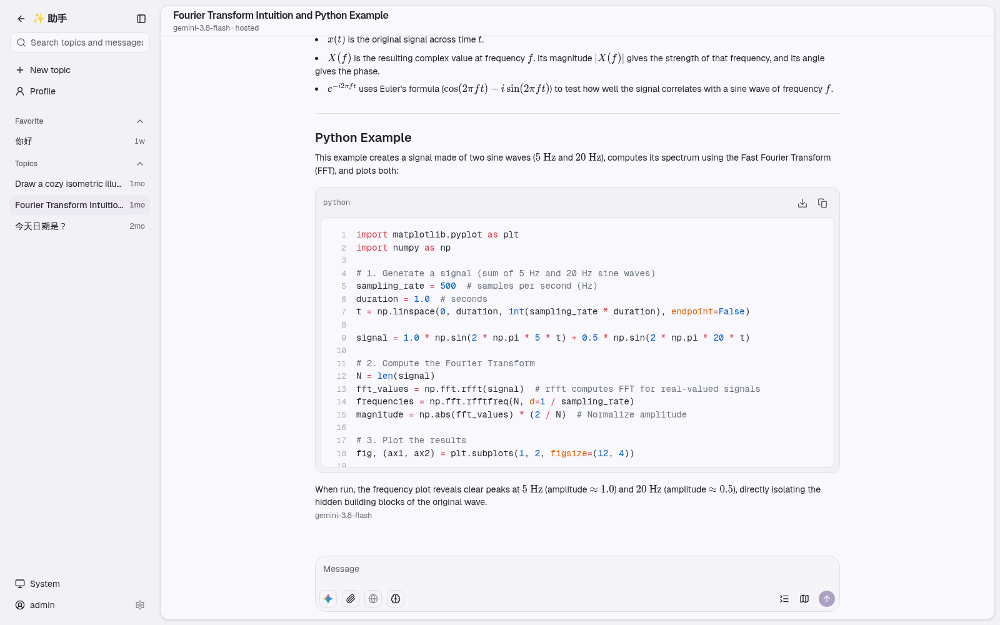
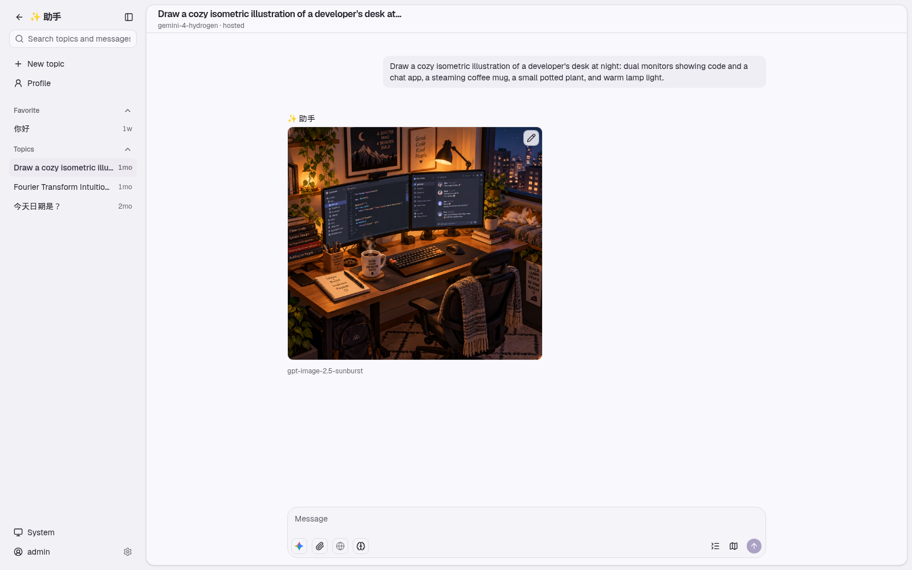
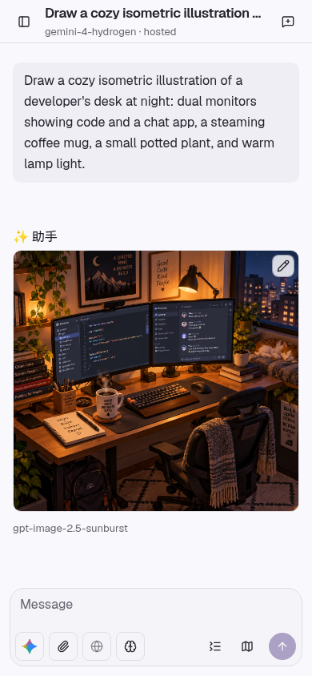

<p align="center">
  
</p>

<h1 align="center">Pika Chat</h1>

<p align="center">
  <strong>专为速度、隐私与完全自主掌控打造的现代化开源自托管多模态 AI 聊天工作台。</strong>
</p>

<p align="center">
  <a href="README.md">English</a> •
  <a href="README.zh-CN.md">简体中文</a> •
  <a href="https://pika-demo.jasonzzx.com">在线体验</a>
</p>

<p align="center">
  
  
  
  
  
  
</p>

---

**Pika Chat** 是一套注重隐私的自托管多模态 AI 聊天系统，面向个人极客与团队协作设计。支持接入各类大模型服务商、AI 图片生成与编辑、联网搜索并提供精确引用来源、多格式文件解析与多模态交互、结构化助手与话题管理，拥有兼顾桌面多屏与触屏移动端的优雅交互界面。

<p align="center">
  
</p>

---

## 在线体验

无需注册账号，直接在浏览器中体验 Pika Chat：**[https://pika-demo.jasonzzx.com](https://pika-demo.jasonzzx.com)** 

- 一键以访客身份试用已配置的大模型与联网搜索功能（受每日试用额度限制）。
- 对话记录与上传文件仅归属当前浏览器会话，并在连续 7 天无活动后自动清理（请勿输入敏感信息）。

---

## 界面预览

| 🎨 AI 图片生成与编辑 | 🌈 主题预设 |
|:---:|:---:|
|  |  |

<p align="center">
  <br/>
  <sub>📱 移动优先、触控友好的对话体验</sub>
</p>

---

## 核心功能

### 💬 对话与工作流
- **后台生成与断点恢复**：回复在服务端托管运行，切换话题、刷新、关闭标签页乃至退出登录后仍可接续实时流式输出，无需额外队列组件。
- **无损编辑与分支重生成**：可就地编辑已发消息或重新生成任意历史回复，生成可切换版本而不截断后续对话。
- **临时对话与草稿保存**：支持开启**临时对话**（离开、关闭页面或闲置 24 小时后自动删除），常规话题自动保存未发送草稿。
- **划词引用、地图与全文搜索**：选中文本即可**引用**并一键跳回原文，支持**聊天地图**概览与 `Ctrl+K` 跨话题全文搜索。
- **上下文压缩、翻译与用量统计**：长对话自动压缩为滚动摘要，支持 8 种语言按版本缓存翻译，以及单条消息 TPS、TTFT 与缓存命中统计。

### 🎨 多模态、生图与联网搜索
- **内置文档解析与模型回退**：上传即解析 PDF、DOCX、XLSX、PPTX、EPUB 及音视频；切换至纯文本模型时自动回退为提取文本，支持 Gemini 与 Anthropic Files API。
- **AI 生图与修图**：支持 OpenAI `gpt-image`、Gemini、Seedream 及万相 / Qwen-Image，并可直接引用已有附件进行编辑。
- **自主联网搜索与抓取**：接入 Brave、Tavily、Exa、Firecrawl 多搜索源与回退链，支持深层网页抓取与行内引用标注。

### 🔐 服务商、存储与权限
- **多服务商编排与密钥安全**：兼容主流模型厂商及任意 OpenAI 格式网关，支持 `/v1/models` 对比同步、AES-256-GCM 密钥加密及私有/共享配置隔离。
- **零配置 SQLite 与可插拔存储**：开箱即用内置 SQLite 与本地磁盘存储，或切换至 S3 兼容对象存储（AWS S3、MinIO、R2、RustFS），支持客户端直传直链（`S3_DIRECT_ACCESS=1`）。
- **权限控制、两步验证与配额**：支持多角色权限（Super Admin / Admin / Member）、TOTP 2FA 及全站/单用户存储配额与孤儿文件自动清理。
- **主题与跨平台客户端**：内置 7 套明暗主题预设与中英双语界面，支持安装为 PWA，并提供免配置本地模式的桌面端与 Android 客户端。

---

## 快速开始

### 方案 1：生产环境独立部署（`docker-compose.yml`，推荐）

通过 `docker-compose.yml` 一键启动应用容器（内置 SQLite 数据库并默认持久化在 `/data/files/pika-chat.db`），搭配本地磁盘或可选外部 S3 对象存储，启动时自动执行数据库迁移。

1. **克隆项目代码**：
   ```bash
   git clone https://github.com/jason-zzx/pika-chat.git
   cd pika-chat
   ```

2. **配置环境变量**：
   ```bash
   cp .env.example .env
   ```
   生成至少 32 字符的安全密钥：
   ```bash
   openssl rand -base64 48
   ```
   编辑 `.env` 文件配置实例密钥与可选外部 S3 存储：
   ```env
   CREDENTIAL_ENCRYPTION_SECRET=你生成的加密密钥
   BETTER_AUTH_SECRET=你生成的会话签名密钥

   # 可选：配置外部 S3 对象存储
   # S3_BUCKET=my-bucket
   # S3_ACCESS_KEY_ID=...
   # S3_SECRET_ACCESS_KEY=...
   ```

3. **启动应用服务**：
   ```bash
   docker compose up -d
   ```

4. **初始化管理员**：
   在浏览器中访问 **`http://localhost:3000/setup`**，按照向导创建首位超级管理员账户。

---

### 方案 2：生产环境一体化部署（`docker-compose.rustfs.yml`，含 RustFS）

内置 RustFS 容器作为 S3 兼容附件存储。沿用上述 `.env` 配置启动全套服务：

```bash
docker compose -f docker-compose.rustfs.yml up -d
```

随后访问 **`http://localhost:3000/setup`** 创建首位超级管理员账户。

---

### 方案 3：本地开发环境搭建

#### 环境要求
- **Node.js**: >= 22
- **pnpm**: 11.9+

#### 操作步骤

1. **克隆并安装依赖**：
   ```bash
   git clone https://github.com/jason-zzx/pika-chat.git
   cd pika-chat
   pnpm install
   ```

2. **配置环境变量**：
   ```bash
   cp .env.example .env
   ```
   编辑 `.env` 文件，保留默认的 `DATABASE_PATH=.data/pika-chat.db`（或按需指定路径），并填入通过 `openssl rand -base64 48` 生成的随机安全密钥。

3. **启动开发服务**（启动时会自动应用 SQLite 迁移，也可随时执行 `pnpm db:migrate`）：
   ```bash
   pnpm dev
   ```

4. 浏览器打开 **`http://localhost:3000/setup`** 完成初始管理员创建。

---

## 数据、备份与升级

实例的全部数据都保存在 `/data/files` 数据卷中（`files_prod_data`，Docker 中的卷名为 `pika-chat_files_prod_data`）：SQLite 数据库 `pika-chat.db` 及其 `pika-chat.db-wal` / `pika-chat.db-shm` 文件，以及存放在本地磁盘的附件。使用 S3 时，附件保存在存储桶中。请将 `CREDENTIAL_ENCRYPTION_SECRET` 与备份一同保管：缺少它，已保存的模型供应商 API Key 将无法解密。

### 数据备份

- **停机备份**：停止应用，复制整个数据卷，然后重新启动（若使用 RustFS 编排，请加上 `-f docker-compose.rustfs.yml`）：
  ```bash
  docker compose stop app
  docker run --rm -v pika-chat_files_prod_data:/data -v "$PWD":/backup alpine tar czf /backup/pika-chat-data.tgz -C /data .
  docker compose start app
  ```
- **在线备份**：使用 `sqlite3 /data/files/pika-chat.db ".backup <目标文件>"` 生成数据库的一致性副本，再复制附件。应用镜像不包含 `sqlite3` 命令行工具，请在挂载了该数据卷的其他容器或宿主机上执行。运行中只复制 `pika-chat.db` 可能会漏掉仍在 `pika-chat.db-wal` 中的最新写入。

### 从 PostgreSQL 升级

v1.0.0 前的版本使用 PostgreSQL 存储数据。首次启动本版本时，系统会自动将 PostgreSQL 中的数据导入到 SQLite（更早版本请先升级至 v0.4.2）：

1. **先只更换镜像版本**：保持原有的 compose 文件与 `.env` 不变，拉取新镜像并重启（`docker compose -f <原-compose-文件> pull && docker compose -f <原-compose-文件> up -d`）。启动时会自动将全部数据导入 `/data/files/pika-chat.db`。
2. **导入完成后再切换 compose 文件**：确认启动成功并导入完毕后，切换为当前的 `docker-compose.yml`（或 `docker-compose.rustfs.yml`）并执行 `docker compose up -d --remove-orphans`。确认数据无误前请保留原 PostgreSQL 数据卷。

> **请勿在导入前切换 compose 文件。** 新版 compose 文件不再连接 PostgreSQL，直接启动会生成全新的空库；若误操作，停止应用并删除数据卷中的 `pika-chat.db*`，再用原 compose 文件重启即可重新导入。

---

## Android 应用

Android 客户端用于连接一个或多个已部署的 Pika Chat 服务器，支持状态栏主题色同步、键盘高度自适应与系统返回手势。应用不内置服务端，需连接远程服务器使用。

- **安装**：前往 [GitHub Releases](https://github.com/jason-zzx/pika-chat/releases) 下载 `Pika-Chat-<版本>.apk` 并安装。
- **多服务器切换**：可添加多个 Pika Chat 服务器并随时切换，各服务器登录会话相互独立。

开发 Android 应用：见 [`native/mobile/README.md`](native/mobile/README.md)。

---

## 桌面应用

桌面客户端（Electron）支持 Windows、macOS 与 Linux，既可在本地“此电脑”模式免配置直接运行，也可连接远程服务器，并支持系统托盘与全局显示/隐藏快捷键。

- **下载**：前往 [GitHub Releases](https://github.com/jason-zzx/pika-chat/releases) 获取。
- **本地模式（“此电脑”）**：首次启动选择“在此电脑上使用”即可在本机免配置运行，数据保存在系统应用数据目录（`<userData>/local/`）。
- **连接远程服务器**：可随时添加并切换多个远程服务器，各服务器登录会话与本地数据相互独立。
- **Windows**：安装包未签名，出现 SmartScreen 提示时点击“更多信息” → “仍要运行”。
- **macOS**：应用未签名，拖入“应用程序”后执行一次 `xattr -dr com.apple.quarantine "/Applications/Pika Chat.app"`。
- **Linux**：GNOME 需安装 AppIndicator 扩展才能显示托盘图标；没有托盘时，再次启动应用即可显示窗口。

开发桌面应用（`native/` 下为独立的 pnpm 工作区）：

```bash
DOCKER_BUILD=1 DATABASE_PATH=:memory: pnpm build
pnpm -C native install --frozen-lockfile
node native/desktop/scripts/build-server.mjs
pnpm -C native -r typecheck && pnpm -C native -r test
pnpm -C native/desktop start                          # 连接本地或远程服务器运行
pnpm -C native/desktop dist --linux AppImage deb rpm  # 本地打包
```

---

## 环境变量配置说明

Pika Chat 通过根目录 `.env` 文件或容器环境进行配置：

| 变量名称 | 是否必填 | 默认值 | 说明 |
|---|:---:|:---:|---|
| `DATABASE_PATH` | **是** | `/data/files/pika-chat.db`（Docker） | SQLite 数据库文件路径（`.env.example` 中为本地开发用的 `.data/pika-chat.db`，临时运行可使用 `:memory:`）。compose 文件将其固定为挂载数据卷上的 `/data/files/pika-chat.db`。 |
| `CREDENTIAL_ENCRYPTION_SECRET` | **是** | — | 用于对模型 API Key 执行 AES-256-GCM 落库加密的密钥（至少 32 字符）。**请务必妥善备份**，一旦丢失将永久无法解密已存凭据。 |
| `BETTER_AUTH_SECRET` | **是** | — | 用于签名 Better Auth 会话令牌的加密密钥（至少 32 字符）。 |
| `APP_URL` | 否 | `http://localhost:3000` | 部署站点的公网访问 URL。在反向代理或自定义域名环境下建议显式配置。 |
| `APP_TRUSTED_ORIGINS` | 否 | — | 额外的受信任来源白名单（逗号分隔，如 `http://192.168.1.100:3000,https://chat.example.com`），用于多地址或局域网访问时的 CSRF 跨域信任。 |
| `FILE_STORAGE_DIR` | 否 | `.data/files` | 本地存储模式下存放附件文件的磁盘物理路径。 |
| `FILE_UPLOAD_MAX_MB` | 否 | `20` | 单个附件允许的最大体积（单位：MiB，有效整数范围：`1`–`100`）。设置超出范围将在启动时报错退出。 |
| `S3_BUCKET` | 否 | — | 设置该项后，附件存储将自动切换为 S3 兼容对象存储。若指定的桶不存在，将在首次写入时自动创建。 |
| `S3_ENDPOINT` | 否 | 官方 AWS 端点 | 自定义 S3 端点（如 `http://minio:9000` 或 `https://<account>.r2.cloudflarestorage.com`）。检测到非 AWS 端点时会自动开启 Path-Style 寻址。 |
| `S3_REGION` | 否 | `us-east-1` | S3 所在地区。 |
| `S3_ACCESS_KEY_ID` | 使用 S3 时必填 | — | S3 访问凭据 Access Key ID。 |
| `S3_SECRET_ACCESS_KEY` | 使用 S3 时必填 | — | S3 访问凭据 Secret Access Key。 |
| `S3_DIRECT_ACCESS` | 否 | 关闭 | 设置为 `1` 或 `true` 开启客户端直传直链模式（前端通过预签名 POST 直传、预签名 302 GET 直接访问）。`0`/`false`/不设置即为关闭。需配合 `S3_BUCKET` 使用。 |
| `PIKA_IMAGE` | 否 | `ghcr.io/jason-zzx/pika-chat:latest` | Compose 编排中拉取的应用容器镜像地址与标签。 |

---

## 存储架构拓扑

```
                                  +-----------------------+
                                  |    本地磁盘物理存储   |
                                  |  (FILE_STORAGE_DIR)   |
                                  +-----------^-----------+
                                              |
+----------+          文件上传 / 下载         | (默认模式)
|  客户端  | <=========================> [ 应用服务器 ]
+----+-----+                                  |
     |                                        | (当配置 S3_BUCKET 时)
     | (当启用 S3_DIRECT_ACCESS=1 时)          v
     |                             +----------------------+
     +---------------------------> | S3 兼容对象存储服务  |
         短期预签名 POST / GET 直传 | AWS S3 / MinIO /     |
                                   | RustFS / Cloudflare  |
                                   +----------------------+
```

- **本地存储**：文件按哈希命名存放在 `FILE_STORAGE_DIR` 目录中。Docker 部署时请通过数据卷（Volume）持久化该目录。
- **S3 存储**：配置 `S3_BUCKET` 后，系统底层透明切换至对象存储驱动，支持冷启动自动建桶。
- **S3 直传直链模式**：开启 `S3_DIRECT_ACCESS=1` 后，上传操作由客户端直接通过预签名 POST 请求送达存储桶，预览与下载则通过 302 重定向到预签名 GET 链接，完全旁路应用服务器流量。请确保存储桶正确配置 CORS 跨域规则：
  ```json
  [
    {
      "AllowedHeaders": ["*"],
      "AllowedMethods": ["POST", "GET", "HEAD"],
      "AllowedOrigins": ["https://your-chat-domain.com"],
      "ExposeHeaders": ["ETag"]
    }
  ]
  ```

---

## 技术选型

- **全栈框架**：[Next.js 16](https://nextjs.org/)（App Router 架构，支持 Standalone 独立输出）
- **前端交互与 UI**：[React 19](https://react.dev/)、[Base UI](https://base-ui.com/)、[Tailwind CSS v4](https://tailwindcss.com/)、[Lucide React](https://lucide.dev/)
- **模型与推理集成**：[Vercel AI SDK](https://sdk.vercel.ai/)（`ai`、`@ai-sdk/openai-compatible`、`@ai-sdk/anthropic`、`@ai-sdk/google`）
- **数据库与持久化**：[SQLite](https://www.sqlite.org/)（[better-sqlite3](https://github.com/WiseLibs/better-sqlite3)）、[Drizzle ORM](https://orm.drizzle.team/)
- **身份认证体系**：[Better Auth](https://better-auth.com/)（内置 TOTP 两步验证）
- **富文本与公式解析**：[Streamdown](https://github.com/streamdown/streamdown)、KaTeX 数学公式、Mermaid 图表、`@streamdown/cjk`、`@streamdown/code`、`@streamdown/math`、`@streamdown/mermaid`
- **文档提取工具集**：`unpdf` (PDF)、`mammoth` (DOCX)、`xlsx` (Excel)、`jszip` (EPUB/PPTX)
- **对象存储适配**：`@aws-sdk/client-s3`、`@aws-sdk/s3-presigned-post`、`@aws-sdk/s3-request-presigner`
- **国际化引擎**：[next-intl](https://next-intl.dev/)
- **桌面与移动客户端**：[Electron](https://www.electronjs.org/)（集成 `electron-updater`）、[Capacitor 8](https://capacitorjs.com/)（Android）
- **测试框架**：[Vitest](https://vitest.dev/)、React Testing Library、`:memory:` SQLite 集成测试套件

---

## 开发与验证规范

每次代码提交前，需通过以下质量门禁：

```bash
# 代码风格校验与静态扫描
pnpm lint

# TypeScript 严格类型检查
pnpm typecheck

# 单元测试与集成测试全量验证
pnpm test
```

数据库结构演进管理：
```bash
# 根据 Drizzle Schema 变动自动生成 SQL 迁移脚本
pnpm db:generate

# 执行数据库结构迁移应用
pnpm db:migrate
```

---

## 开源协议

本项目采用 MIT 许可证开源。
