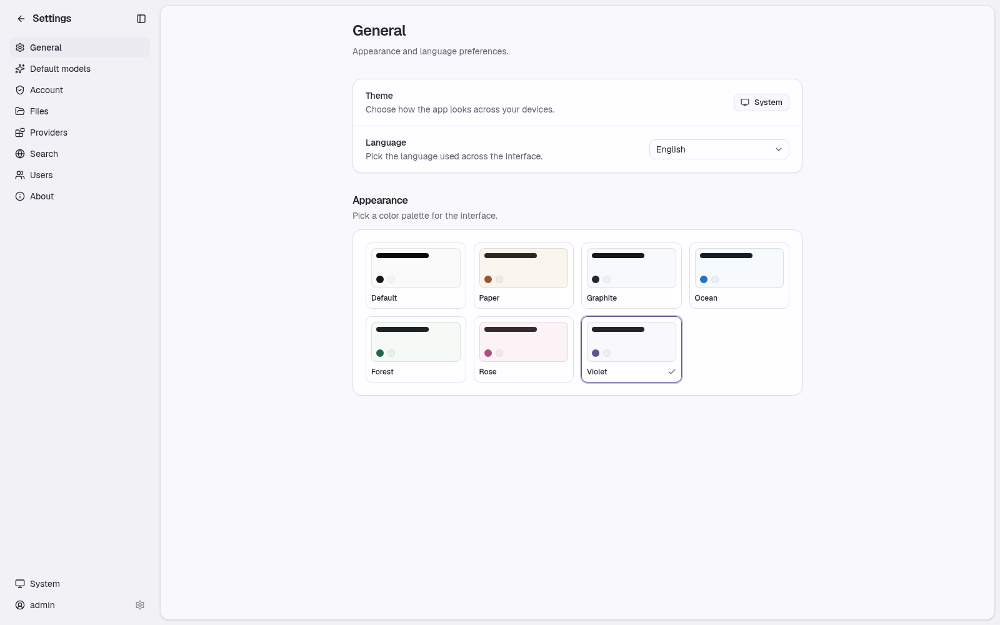

<p align="center">
  
</p>

<h1 align="center">Pika Chat</h1>

<p align="center">
  <strong>专为速度、隐私与完全自主掌控打造的现代化开源自托管多模态 AI 聊天工作台。</strong>
</p>

<p align="center">
  <a href="README.md">English</a> •
  <a href="README.zh-CN.md">简体中文</a> •
  <a href="https://pika-demo.jasonzzx.com">在线体验</a>
</p>

<p align="center">
  
  
  
  
  
  
</p>

---

**Pika Chat** 是一套注重隐私的自托管多模态 AI 聊天系统，面向个人极客与团队协作设计。支持接入各类大模型服务商、AI 图片生成与编辑、联网搜索并提供精确引用来源、多格式文件解析与多模态交互、结构化助手与话题管理，拥有兼顾桌面多屏与触屏移动端的优雅交互界面。

<p align="center">
  
</p>

---

## 在线体验

无需注册账号，直接在浏览器中体验 Pika Chat：**[https://pika-demo.jasonzzx.com](https://pika-demo.jasonzzx.com)** 

- 一键以访客身份试用已配置的大模型与联网搜索功能（受每日试用额度限制）。
- 对话记录与上传文件仅归属当前浏览器会话，并在连续 7 天无活动后自动清理（请勿输入敏感信息）。

---

## 核心特性

- **零维护开箱即用理念**：提供开箱即用的合理默认配置——本地磁盘存储、启动自动迁移数据库、S3 存储桶首次访问自动创建、孤儿文件自动回收清理。
- **隐私与安全至上**：服务商 API Key 落库采用 AES-256-GCM 认证加密；支持多角色权限控制（RBAC）、TOTP 两步验证（2FA）及用户存储配额隔离。
- **全能多模态文件支持**：支持拖拽上传图片、多格式文档（PDF、DOCX、XLSX、PPTX、EPUB、TXT、Markdown）、音频及视频；即时提取文本，并在跨模型切换时实现多模态与文本回退动态自适应。
- **现代高性能架构**：基于 Next.js 16 App Router、React 19、Tailwind CSS v4 构建；支持服务端托管后台生成与流式恢复、防抖动态滚屏与平滑贴底，可选 S3 客户端直传技术极大降低服务器负载。

---

## 功能亮点

### 🤖 多服务商与模型编排
- **广泛兼容的接口协议**：原生支持 OpenAI、Anthropic (Claude)、Google Gemini、Ollama、OpenRouter、DeepSeek、Groq、Mistral、Moonshot 及任意兼容 OpenAI 的第三方中转或本地网关。
- **接口模型自动发现**：一键从服务商端点（`/v1/models`）自动发现并同步可用模型列表。
- **精细化模型参数配置**：独立设置模型上下文窗口上限、思考推演力度（Reasoning Effort / Thinking）、支持的输入模态以及自定义厂商图标。
- **密钥安全加密**：所有 API Key 在数据库中均经过 AES-256-GCM 加密存储（依赖 `CREDENTIAL_ENCRYPTION_SECRET`），不向客户端泄露，不输出日志。
- **默认模型偏好**：可为日常对话、标题生成、上下文压缩、消息翻译分别指定个人默认模型，在所有会话中自动生效。
- **私有与全员共享**：支持将经过验证的服务商配置一键共享给全站成员，亦可保留个人私有密钥。

### 💬 卓越的对话交互体验
- **后台生成与流式恢复**：对话与图片生成由服务端任务托管，切换话题、刷新页面、关闭标签页乃至退出登录都不会中断生成；返回话题即可接续实时流式输出或直接看到已完成结果，内置定期检查点且无需额外部署组件。
- **用户消息就地编辑**：可直接在消息列表中编辑已发送的用户消息（文本与附件均可修改），生成可切换的新版本并自动重新生成下方助手回复，且不会截断后续对话。
- **非末尾消息分支重新生成**：支持重新生成任意历史助手回复，不丢弃、不截断后续上下文。通过 `group_id` 与服务端持久化选择状态管理多版本分支。
- **单条消息 Token 与性能统计**：每条助手回复展示输入/输出 Token 数与输出速度（TPS），悬停或点按可查看缓存命中 Token、命中率、首 Token 延迟（TTFT）及总耗时。
- **富文本 Markdown 与代码高亮渲染**：基于 Streamdown 构建，支持实时 KaTeX 数学公式渲染、交互式 Mermaid 图表、语法高亮代码块（支持一键复制），以及针对中文标点排版优化的 CJK 文本渲染。
- **上下文历史压缩**：当对话长度接近模型上下文预算（约 80%）时自动将早期对话压缩为滚动摘要，支持在输入框一键手动压缩，摘要可在消息列表中折叠查看。
- **按需消息翻译**：任意问答消息可一键翻译为 8 种语言，按消息版本持久化缓存，并保留引用来源链接。
- **智能平滑滚动控制**：回复生成期间通过底部预留高度算法防止页面频繁跳动，同时监听用户滚轮、触摸手势与滚动条拖拽，自然取消强行贴底吸附。
- **移动端深度适配**：自适应分栏布局、移动端轻触唤出操作菜单（彻底摆脱桌面悬停依赖）、无遮罩式原生级下拉选择组件。
- **助手与话题分类**：支持针对特定工作流创建专属 Prompt 与默认模型的助手，支持话题置顶、浏览器标签页标题同步与对话记录导出。
- **全文消息搜索**：支持跨话题与消息的全文搜索，通过 `Ctrl+K` 命令面板快速定位，并提供话题内搜索结果上下跳转。

### 📎 多模态附件与文档解析引擎
- **广泛的文件格式解析**：
  - **文档**：PDF、Word (`.docx`)、Excel (`.xlsx`)、PowerPoint (`.pptx`)、EPUB、纯文本及 Markdown。
  - **音视频与多媒体**：JPEG、PNG、GIF、WebP、WAV、MP3、MPEG、MP4、WebM。
- **上传即解析**：上传时即时完成文档内容提取，统计页数与字符，自动清除 C0 控制字符，在发送前以预览标签呈现解析状态与字数提示。
- **动态模型上下文回放**：向支持视觉/音频的先进模型发送原生多模态数据；在历史会话切换至仅支持文本的模型时，自动退回到已缓存的文档纯文本提取内容。
- **厂商 Files API 深度协同**：对接 Gemini 与 Anthropic 的官方文件 API，内置文件有效期追踪与过期懒重传策略。

### 🎨 AI 图片生成与编辑
- **多厂商图片模型**：支持 OpenAI gpt-image、Google Gemini 图片模型、字节跳动 Seedream 及阿里云万相 / Qwen-Image 的文生图与图片编辑。
- **按模型校验的参数预设**：分辨率、宽高比、画质与批量张数等选项均按各模型家族的真实约束校验。
- **参考图编辑**：可直接引用已有附件作为编辑参考图，无需重复上传。
- **配额感知持久化**：生成图片作为普通附件存储，计入相同的用户存储配额。

### 🔍 实时联网搜索与引用来源
- **大模型 Function Calling 工具调用**：模型根据用户问题智能判断是否需要执行联网搜索。
- **多搜索源与故障回退**：支持接入 Brave Search、Tavily、Exa、Firecrawl，支持自定义回退链。
- **深层页面抓取**：内置 `fetchPage` 工具深度抓取落地页网页内容，辅助模型生成详尽回答。
- **规范化溯源引用**：全局统一分配单次对话唯一的引用序号（`[1]`, `[2]`），精准关联原文来源。

### 🗄️ 可插拔存储：本地磁盘与 S3 兼容对象存储
- **零配置本地磁盘存储**：无需额外准备对象存储，附件默认存放在本地磁盘（`.data/files`）。
- **标准 S3 兼容协议支持**：配置 `S3_BUCKET` 即可无缝切换至 AWS S3、MinIO、Cloudflare R2 或 RustFS；存储桶在初次使用时自动建立。
- **客户端直传直链模式 (`S3_DIRECT_ACCESS=1`)**：彻底释放应用服务器带宽——浏览器通过短期预签名 POST 策略直传 S3 存储桶，通过 302 重定向直连预签名 GET 链接下载与预览文件。
- **内置 RustFS 容器套件**：一行命令即可同时启动全套自托管应用与高性能轻量级 S3 兼容存储。

### 🛡️ 完善的用户权限体系与配额管理
- **Better Auth 驱动**：支持邮箱/密码认证与 TOTP 两步验证（2FA）。
- **开箱初始化向导**：首次部署自动引导访问 `/setup` 初始化超级管理员，无需手动修改数据库。
- **多级权限分权**：超级管理员（Super Admin）、管理员（Admin）与普通用户（Member）分级授权机制。
- **文件存储配额控制**：支持设置全站默认配额（默认 5 GiB）及按用户定制配额，内置后台孤儿文件扫描与清理。
- **全站运营配置**：在管理员控制台轻松切换开放注册/关闭注册，一键封禁恶意用户或重置密码。

### 🌐 主题与国际化
- **精选主题预设**：内置 6 款主题（Paper、Graphite、Ocean、Forest、Rose、Violet）及默认中性主题，每款均提供明暗两套配色，按用户持久化并在服务端渲染时直接注入，无闪烁切换。
- **双语界面**：完整内置**英文**与**简体中文**界面语言包，可在**设置 → 通用**中随时切换。

---

## 界面预览

| 🎨 AI 图片生成与编辑 | 🌈 主题预设 |
|:---:|:---:|
|  |  |

<p align="center">
  <br/>
  <sub>📱 移动优先、触控友好的对话体验</sub>
</p>

---

## 快速开始

### 方案 1：生产环境全能一体化部署（`docker-compose.full.yml`，推荐）

通过 Docker 一键拉起应用服务（内置 SQLite 数据库并默认持久化在 `/data/files/pika-chat.db`）及 RustFS（S3 兼容附件存储），内置数据卷持久化并在启动时自动执行数据库迁移。默认直接拉取官方预构建镜像（`ghcr.io/jason-zzx/pika-chat:latest`），无需本地编译。

1. **克隆项目代码**：
   ```bash
   git clone https://github.com/jason-zzx/pika-chat.git
   cd pika-chat
   ```

2. **配置环境变量**：
   ```bash
   cp .env.example .env
   ```
   生成并填入安全密钥（需至少 32 字符）：
   ```bash
   openssl rand -base64 48
   ```
   编辑 `.env` 文件，填入生成的随机密钥：
   ```env
   CREDENTIAL_ENCRYPTION_SECRET=你生成的加密密钥
   BETTER_AUTH_SECRET=你生成的会话签名密钥
   ```

3. **启动全套生产服务**：
   ```bash
   docker compose -f docker-compose.full.yml up -d
   ```

4. **初始化管理员**：
   在浏览器中访问 **`http://localhost:3000/setup`**，按照向导创建首位超级管理员账户。

---

### 方案 2：生产环境独立应用部署（`docker-compose.standalone.yml`）

通过 `docker-compose.standalone.yml` 单独启动应用容器（内置 SQLite 存储于 `/data/files/pika-chat.db`），搭配本地磁盘或可选外部 S3 对象存储，无需多余容器：

1. **克隆项目代码**：
   ```bash
   git clone https://github.com/jason-zzx/pika-chat.git
   cd pika-chat
   ```

2. **配置环境变量**：
   ```bash
   cp .env.example .env
   ```
   编辑 `.env` 文件配置实例密钥与可选外部 S3 存储：
   ```env
   CREDENTIAL_ENCRYPTION_SECRET=你生成的加密密钥
   BETTER_AUTH_SECRET=你生成的会话签名密钥

   # 可选：配置外部 S3 对象存储
   # S3_BUCKET=my-bucket
   # S3_ACCESS_KEY_ID=...
   # S3_SECRET_ACCESS_KEY=...
   ```

3. **启动独立应用服务**：
   ```bash
   docker compose -f docker-compose.standalone.yml up -d
   ```

---

### 方案 3：本地开发环境搭建

#### 环境要求
- **Node.js**: >= 22
- **pnpm**: 11.9+

#### 操作步骤

1. **克隆并安装依赖**：
   ```bash
   git clone https://github.com/jason-zzx/pika-chat.git
   cd pika-chat
   pnpm install
   ```

2. **配置环境变量**：
   ```bash
   cp .env.example .env
   ```
   编辑 `.env` 文件，保留默认的 `DATABASE_PATH=.data/pika-chat.db`（或按需指定路径），并填入通过 `openssl rand -base64 48` 生成的随机安全密钥。

3. **启动开发服务**（启动时会自动应用 SQLite 迁移，也可随时执行 `pnpm db:migrate`）：
   ```bash
   pnpm dev
   ```

4. 浏览器打开 **`http://localhost:3000/setup`** 完成初始管理员创建。

---

## 数据、备份与升级

实例的全部数据都保存在 `/data/files` 数据卷中（`files_prod_data`，Docker 中的卷名为 `pika-chat_files_prod_data`）：SQLite 数据库 `pika-chat.db` 及其 `pika-chat.db-wal` / `pika-chat.db-shm` 文件，以及存放在本地磁盘的附件。使用 S3 时，附件保存在存储桶中。请将 `CREDENTIAL_ENCRYPTION_SECRET` 与备份一同保管：缺少它，已保存的模型供应商 API Key 将无法解密。

### 数据备份

- **停机备份**：停止应用，复制整个数据卷，然后重新启动：
  ```bash
  docker compose -f docker-compose.full.yml stop app
  docker run --rm -v pika-chat_files_prod_data:/data -v "$PWD":/backup alpine tar czf /backup/pika-chat-data.tgz -C /data .
  docker compose -f docker-compose.full.yml start app
  ```
- **在线备份**：使用 `sqlite3 /data/files/pika-chat.db ".backup <目标文件>"` 生成数据库的一致性副本，再复制附件。应用镜像不包含 `sqlite3` 命令行工具，请在挂载了该数据卷的其他容器或宿主机上执行。运行中只复制 `pika-chat.db` 可能会漏掉仍在 `pika-chat.db-wal` 中的最新写入。

### 从 PostgreSQL 升级

v1.0.0-rc.1 及更早的版本将数据保存在 PostgreSQL 中。本版本首次启动时会自动将该数据库复制到 SQLite：

1. **只更换镜像。** 首次启动时保持现有的 compose 文件与 `.env`（或现有的容器环境变量）不变，让 PostgreSQL 继续运行、其连接配置仍能传入应用。如果通过 `PIKA_IMAGE` 固定了镜像版本，请先改为新版本标签，然后使用您部署时所用的 compose 文件拉取并重启：
   ```bash
   docker compose -f docker-compose.full.yml pull
   docker compose -f docker-compose.full.yml up -d
   ```
2. **启动时自动导入。** 当服务端读到原有的 PostgreSQL 连接配置且 SQLite 中没有导入标记时，会在一个只读快照中读取 PostgreSQL，在单个事务内将所有表复制到 `/data/files/pika-chat.db`，校验行数与外键并写入导入标记，之后才开始对外提供服务。日志会逐表报告进度。整个过程不会写入 PostgreSQL。
3. **导入失败时**，服务端不会启动，并在日志中给出原因（例如 PostgreSQL 无法连接，或 SQLite 数据库中已有数据）。SQLite 保持为空，排除原因后重启即会重新尝试。PostgreSQL 必须处于 v0.4.0 – v1.0.0-rc.1 的数据库结构；更早的实例请先升级到 v0.4.2。
4. **导入完成后**，之后的启动都会忽略 PostgreSQL 的配置。此时可切换到当前版本的 compose 文件（其中已没有 `postgres` 服务）并执行 `docker compose -f docker-compose.full.yml up -d --remove-orphans`。在确认数据无误前请保留旧的 PostgreSQL 数据卷；回退只需换回之前的镜像与 compose 文件。

> **请在导入完成后再切换 compose 文件。** 当前版本的 compose 文件不再连接 PostgreSQL，若直接用它们首次启动，服务端会作为全新安装启动；完成 `/setup` 后数据库不再为空，导入会被拒绝。补救方法：停止应用，删除数据卷中的 `pika-chat.db*`，再用之前的 compose 文件重新启动。

桌面端不会迁移 v1.0.0-rc.1 本地模式的数据：本地模式将使用位于 `<userData>/local/pika-chat.db` 的全新数据库，旧数据原样保留在 `<userData>/local/db/` 中。

---

## Android 应用

Android 应用（APK，Android 7.0+）可连接一个或多个已部署的 Pika Chat 服务器，系统状态栏与导航栏跟随主题色，输入框始终位于键盘上方，支持返回键与回复完成通知。应用不内置服务端，请连接远程服务器。

- **安装**：前往 [GitHub Releases](https://github.com/jason-zzx/pika-chat/releases) 下载 `Pika-Chat-<版本>.apk` 并打开；系统会提示允许浏览器或文件管理器安装未知来源应用。
- **服务器**：首次启动会打开“添加服务器”表单；可通过侧边栏品牌行、账户菜单或登录页右上角芯片调出原生选择框切换服务器，每个服务器拥有独立的登录会话。
- **通知**：Android 13+ 在首次连接成功后请求通知权限。Android 会在应用进入后台约 10 秒后冻结它，因此仅当回复在应用打开或刚离开时完成才会弹出通知；重新打开应用即可看到已完成的回复。
- **更新**：应用在启动时及“设置”中检查 GitHub Releases，并提供新 APK 的链接。
- **要求**：保持 Android System WebView 为最新版（可在 Google Play 更新），否则应用会提示更新。

开发 Android 应用：见 [`native/mobile/README.md`](native/mobile/README.md)。

---

## 桌面应用

Electron 桌面客户端支持 Windows、macOS 与 Linux，既可在本地“此电脑”模式免配置直接运行 Pika Chat，也可连接一个或多个已部署的远程服务器，并提供托盘图标、全局显示/隐藏快捷键、回复完成通知和自动更新。

- **下载**：前往 [GitHub Releases](https://github.com/jason-zzx/pika-chat/releases)，获取 Windows 安装包（`.exe`）、macOS `.dmg`（Intel 与 Apple Silicon）、Linux `.AppImage` / `.deb` / `.rpm`。
- **本地使用（“此电脑”）**：首次启动选择“在此电脑上使用”，即可启动内置本地服务（内嵌 SQLite 数据库与 Next 独立服务端），仅监听 `127.0.0.1`。对话记录、上传文件、密钥凭据与日志均保存在系统应用数据目录（`<userData>/local/`）中，应用升级时保留不变。
- **连接远程服务器**：可选择“连接到服务器”，或随时通过侧边栏服务器切换器、账户菜单或托盘切换。每个服务器拥有独立的登录会话；本地与远程数据相互独立，切换时互不影响，本地服务会在后台保持运行直到退出应用。
- **更新**：Windows 与 Linux 在应用内更新；`.deb` / `.rpm` 在选择“重启并安装”时会要求输入管理员密码；macOS 会弹出提示并跳转到新版本发布页。
- **Windows**：安装包未签名，出现 SmartScreen 提示时点击“更多信息” → “仍要运行”。
- **macOS**：应用未签名，拖入“应用程序”后执行一次 `xattr -dr com.apple.quarantine "/Applications/Pika Chat.app"`。
- **Linux**：GNOME 需安装 AppIndicator 扩展才能显示托盘图标；没有托盘时，再次启动应用或按全局快捷键（默认 `Ctrl+Shift+Space`）即可显示窗口。

开发桌面应用（`native/` 下为独立的 pnpm 工作区）：

```bash
DOCKER_BUILD=1 DATABASE_PATH=:memory: pnpm build
pnpm -C native install --frozen-lockfile
node native/desktop/scripts/build-server.mjs
pnpm -C native -r typecheck && pnpm -C native -r test
pnpm -C native/desktop start                          # 连接本地或远程服务器运行
pnpm -C native/desktop dist --linux AppImage deb rpm  # 本地打包
```

---

## 环境变量配置说明

Pika Chat 通过根目录 `.env` 文件或容器环境进行配置：

| 变量名称 | 是否必填 | 默认值 | 说明 |
|---|:---:|:---:|---|
| `DATABASE_PATH` | **是** | `/data/files/pika-chat.db`（Docker） | SQLite 数据库文件路径（`.env.example` 中为本地开发用的 `.data/pika-chat.db`，临时运行可使用 `:memory:`）。compose 文件将其固定为挂载数据卷上的 `/data/files/pika-chat.db`。 |
| `CREDENTIAL_ENCRYPTION_SECRET` | **是** | — | 用于对模型 API Key 执行 AES-256-GCM 落库加密的密钥（至少 32 字符）。**请务必妥善备份**，一旦丢失将永久无法解密已存凭据。 |
| `BETTER_AUTH_SECRET` | **是** | — | 用于签名 Better Auth 会话令牌的加密密钥（至少 32 字符）。 |
| `APP_URL` | 否 | `http://localhost:3000` | 部署站点的公网访问 URL。在反向代理或自定义域名环境下建议显式配置。 |
| `APP_TRUSTED_ORIGINS` | 否 | — | 额外的受信任来源白名单（逗号分隔，如 `http://192.168.1.100:3000,https://chat.example.com`），用于多地址或局域网访问时的 CSRF 跨域信任。 |
| `FILE_STORAGE_DIR` | 否 | `.data/files` | 本地存储模式下存放附件文件的磁盘物理路径。 |
| `FILE_UPLOAD_MAX_MB` | 否 | `20` | 单个附件允许的最大体积（单位：MiB，有效整数范围：`1`–`100`）。设置超出范围将在启动时报错退出。 |
| `S3_BUCKET` | 否 | — | 设置该项后，附件存储将自动切换为 S3 兼容对象存储。若指定的桶不存在，将在首次写入时自动创建。 |
| `S3_ENDPOINT` | 否 | 官方 AWS 端点 | 自定义 S3 端点（如 `http://minio:9000` 或 `https://<account>.r2.cloudflarestorage.com`）。检测到非 AWS 端点时会自动开启 Path-Style 寻址。 |
| `S3_REGION` | 否 | `us-east-1` | S3 所在地区。 |
| `S3_ACCESS_KEY_ID` | 使用 S3 时必填 | — | S3 访问凭据 Access Key ID。 |
| `S3_SECRET_ACCESS_KEY` | 使用 S3 时必填 | — | S3 访问凭据 Secret Access Key。 |
| `S3_DIRECT_ACCESS` | 否 | 关闭 | 设置为 `1` 或 `true` 开启客户端直传直链模式（前端通过预签名 POST 直传、预签名 302 GET 直接访问）。`0`/`false`/不设置即为关闭。需配合 `S3_BUCKET` 使用。 |
| `PIKA_IMAGE` | 否 | `ghcr.io/jason-zzx/pika-chat:latest` | Compose 编排中拉取的应用容器镜像地址与标签。 |

---

## 存储架构拓扑

```
                                  +-----------------------+
                                  |    本地磁盘物理存储   |
                                  |  (FILE_STORAGE_DIR)   |
                                  +-----------^-----------+
                                              |
+----------+          文件上传 / 下载         | (默认模式)
|  客户端  | <=========================> [ 应用服务器 ]
+----+-----+                                  |
     |                                        | (当配置 S3_BUCKET 时)
     | (当启用 S3_DIRECT_ACCESS=1 时)          v
     |                             +----------------------+
     +---------------------------> | S3 兼容对象存储服务  |
         短期预签名 POST / GET 直传 | AWS S3 / MinIO /     |
                                   | RustFS / Cloudflare  |
                                   +----------------------+
```

- **本地存储**：文件按哈希命名存放在 `FILE_STORAGE_DIR` 目录中。Docker 部署时请通过数据卷（Volume）持久化该目录。
- **S3 存储**：配置 `S3_BUCKET` 后，系统底层透明切换至对象存储驱动，支持冷启动自动建桶。
- **S3 直传直链模式**：开启 `S3_DIRECT_ACCESS=1` 后，上传操作由客户端直接通过预签名 POST 请求送达存储桶，预览与下载则通过 302 重定向到预签名 GET 链接，完全旁路应用服务器流量。请确保存储桶正确配置 CORS 跨域规则：
  ```json
  [
    {
      "AllowedHeaders": ["*"],
      "AllowedMethods": ["POST", "GET", "HEAD"],
      "AllowedOrigins": ["https://your-chat-domain.com"],
      "ExposeHeaders": ["ETag"]
    }
  ]
  ```

---

## 技术选型

- **全栈框架**：[Next.js 16](https://nextjs.org/)（App Router 架构，支持 Standalone 独立输出）
- **前端交互与 UI**：[React 19](https://react.dev/)、[Base UI](https://base-ui.com/)、[Tailwind CSS v4](https://tailwindcss.com/)、[Lucide React](https://lucide.dev/)
- **模型与推理集成**：[Vercel AI SDK](https://sdk.vercel.ai/)（`ai`、`@ai-sdk/openai-compatible`、`@ai-sdk/anthropic`、`@ai-sdk/google`）
- **数据库与持久化**：[SQLite](https://www.sqlite.org/)（[better-sqlite3](https://github.com/WiseLibs/better-sqlite3)）、[Drizzle ORM](https://orm.drizzle.team/)
- **身份认证体系**：[Better Auth](https://better-auth.com/)（内置 TOTP 两步验证）
- **富文本与公式解析**：[Streamdown](https://github.com/streamdown/streamdown)、KaTeX 数学公式、Mermaid 图表、`@streamdown/cjk` 文本优化
- **文档提取工具集**：`unpdf` (PDF)、`mammoth` (DOCX)、`xlsx` (Excel)、`jszip` (EPUB/PPTX)
- **对象存储适配**：`@aws-sdk/client-s3`、`@aws-sdk/s3-presigned-post`、`@aws-sdk/s3-request-presigner`
- **国际化引擎**：[next-intl](https://next-intl.dev/)
- **测试框架**：[Vitest](https://vitest.dev/)、React Testing Library、`:memory:` SQLite 集成测试套件

---

## 开发与验证规范

每次代码提交前，需通过以下质量门禁：

```bash
# 代码风格校验与静态扫描
pnpm lint

# TypeScript 严格类型检查
pnpm typecheck

# 单元测试与集成测试全量验证
pnpm test
```

数据库结构演进管理：
```bash
# 根据 Drizzle Schema 变动自动生成 SQL 迁移脚本
pnpm db:generate

# 执行数据库结构迁移应用
pnpm db:migrate
```

---

## 开源协议

本项目采用 MIT 许可证开源。
